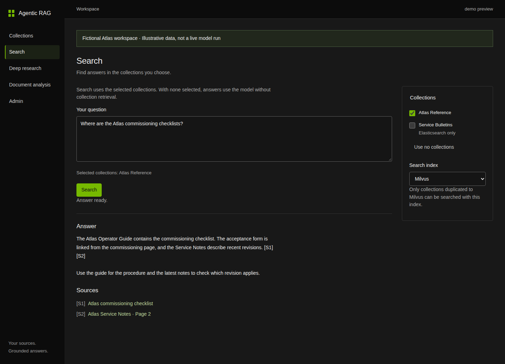

# Agentic RAG on NVIDIA Run:ai

Collection-based ingestion and search with NVIDIA Nemotron models, NeMo Retriever extraction, Elasticsearch and optional GPU-accelerated Milvus/CAGRA.

- Upload files, use administrator-approved directories or crawl scoped websites. Configure source schedules and track changes with content hashes.
- Ingest webpage text independently of linked binary downloads, image extraction and optional asynchronous captioning. Keep source/asset lineage and complete legal subtext.
- Use PostgreSQL transactions, an outbox, Redis Streams, bounded retries and independent writers to track publication. Elasticsearch receives every collection; selected collections also publish to Milvus. Copy existing collections to Milvus from collection management.
- Search across selected collections with a global top 10, rerank to 5 and stream the answer with source links. Select deep research explicitly. With no collection selected, use model-only answers.
- Manage sources, schedules, image-origin breakdowns and actionable errors. A dedicated local admin login controls approved directory aliases.

## Explore the interface

The [visual GUI walkthrough and field reference](docs/gui/README.md) follows a fictional Atlas Reference collection through uploads, website crawling, connected locations, schedules, search and admin controls. Screenshots are illustrative, with no production data or benchmark results.

[](docs/gui/README.md)

## Deploy

Deploy with the [application/model Helm chart](charts/agentic-rag), optional [datastore chart](charts/agentic-rag-infrastructure), and [YAML values examples](deployment/helm). Follow the [Run:ai runbook](RUNAI_RUNBOOK.md) for project, storage, model and secret setup. The repository contains application/runtime source, synthetic tests, portable deployment templates and [flow diagrams](diagrams/README.md). Deployment values, credentials, downloaded content and model weights are supplied separately.

The qualified extraction library is `nemo-retriever==26.8.2`, with three hash-verified compatibility patches. NIM model templates use `:latest` and `Always`; record the resolved image/model revision before admitting new data. Updating a model does not make old vectors compatible automatically.

```bash
docker build -t YOUR_REGISTRY/agentic-rag:release .
docker run --rm --runtime runc --network none --entrypoint python \
  YOUR_REGISTRY/agentic-rag:release tools/test.py
```

The NVIDIA base image requires the appropriate registry access and NVIDIA/model terms. The build downloads dependencies and matching Chrome/ChromeDriver binaries; it does not require an existing application image from another cluster. Deployment targets Linux x86-64 and Python 3.12. Uploaded documents and webpages remain the source of record.

Elasticsearch and Milvus do not participate in a shared database transaction. PostgreSQL tracks each required projection and controls logical publication, retry and recovery. Readers see the committed collection view after the required receipts have been verified.

Temporary document-only analysis and document-level graph/abstract experimentation are outside this release. External enterprise IAM integration is installation-specific; the included local admin is for local phase-1 operation.

Third-party notices are in [THIRD_PARTY_NOTICES.md](THIRD_PARTY_NOTICES.md). No license file is supplied for original application code.

The left navigation separates **Search**, **Deep research** and **Document analysis**. Research is an explicit local collection job with persisted progress and a downloadable report. Document analysis provides an owned, expiring workspace, optional async PDF captions and an authorized Add to collection action. See the [GUI walkthrough](docs/gui/README.md#search-and-research-modes) and [private analysis setup](RUNAI_RUNBOOK.md#search-research-and-private-document-analysis). Private processing requires separately provisioned identities, storage and queues; it is disabled in Helm values until configured.
