# Functional flows

Click a diagram to open its full-size SVG. Labels use native SVG text; editable Mermaid sources are linked below each preview.

## Document analysis and durable research

[Mermaid source](document-analysis-and-research.mmd) · [Full-size SVG](document-analysis-and-research.svg)

## Search and streaming

[Mermaid source](simple-search-flow.mmd) · [Full-size SVG](simple-search-flow.svg)

## Independent webpage and asset processing

[Mermaid source](independent-web-ingestion.mmd) · [Full-size SVG](independent-web-ingestion.svg)

## Asset lifecycle

[Mermaid source](asset-lifecycle.mmd) · [Full-size SVG](asset-lifecycle.svg)

## Collection publication

[Mermaid source](collection-publication.mmd) · [Full-size SVG](collection-publication.svg)

## Provenance

[Mermaid source](provenance-flow.mmd) · [Full-size SVG](provenance-flow.svg)

## Source rechecks

[Mermaid source](source-rechecks.mmd) · [Full-size SVG](source-rechecks.svg)

## Images, captions and approved locations

[Mermaid source](visual-caption-location-flow.mmd) · [Full-size SVG](visual-caption-location-flow.svg)

## Regenerate previews

Install Node.js/npm and Chrome, then run `python3 diagrams/render.py`. Set `CHROME_BIN` if Chrome is not on PATH. Previews are checked in so viewing the diagrams does not require a local renderer.
