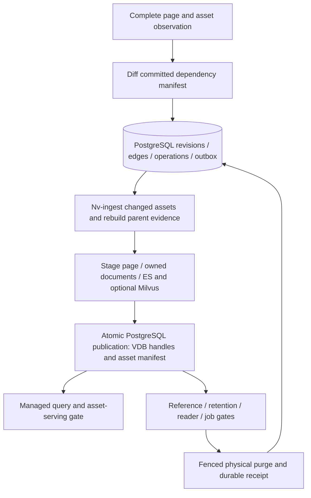
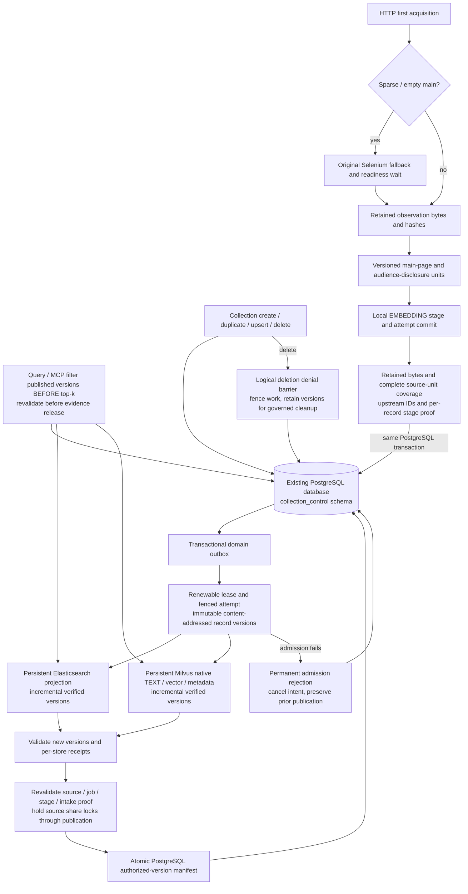
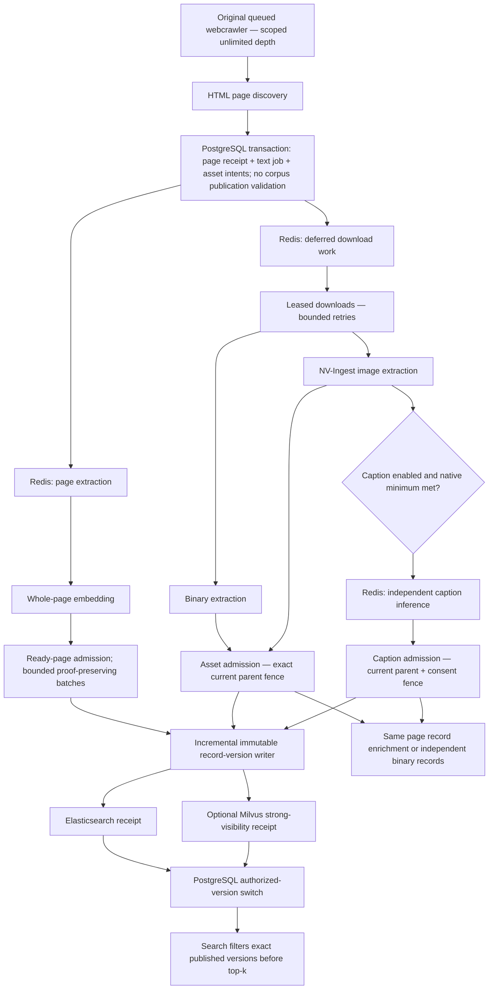
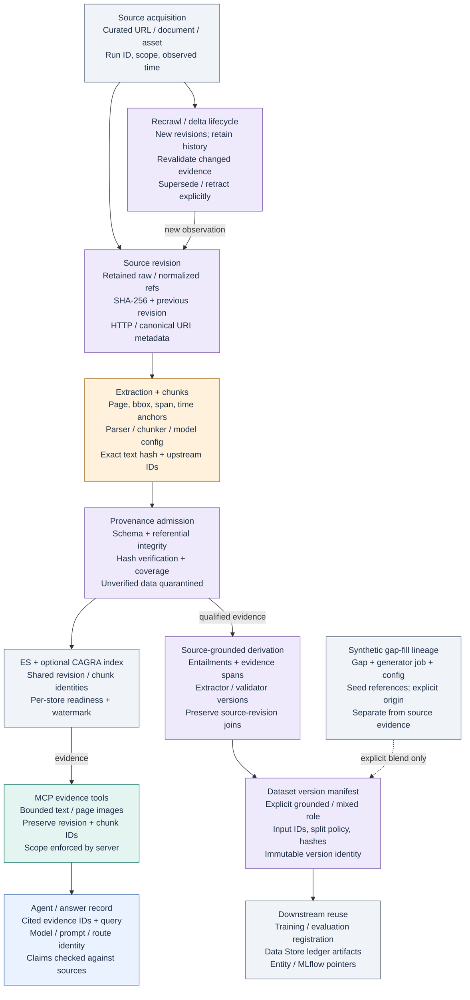
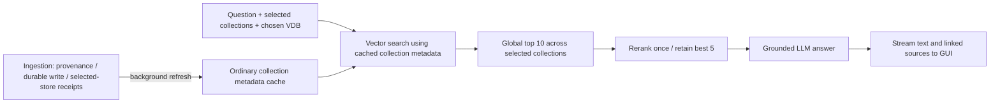
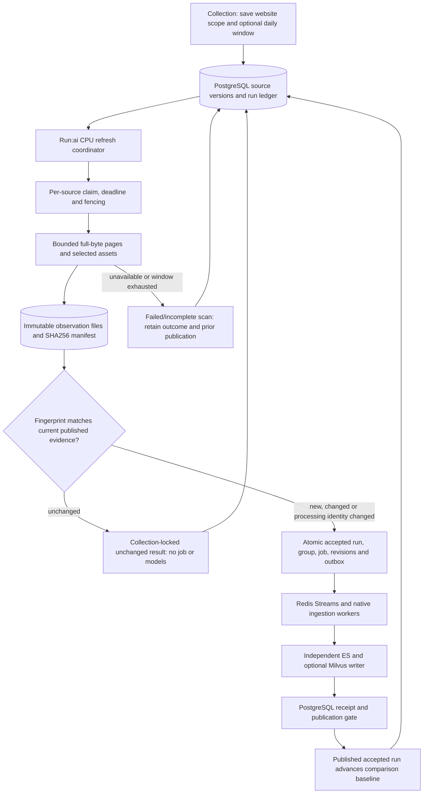
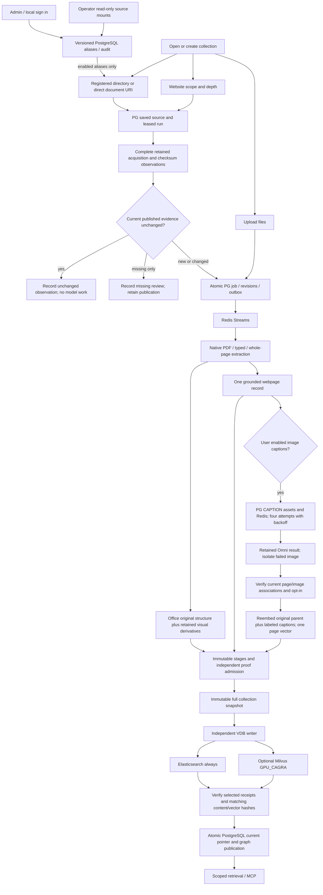

# Functional flows

These Mermaid diagrams describe the included runtime. Raw `.mmd` sources are linked below:

- [Search and streaming](simple-search-flow.mmd)
- [Independent webpage and asset processing](independent-web-ingestion.mmd)
- [Asset lifecycle](asset-lifecycle.mmd)
- [Collection publication](collection-publication.mmd)
- [Provenance](provenance-flow.mmd)
- [Source rechecks](source-rechecks.mmd)
- [Images, captions and approved locations](visual-caption-location-flow.mmd)

## Asset lifecycle

## Collection publication

## Independent web ingestion

## Provenance flow

## Simple search flow

## Source rechecks

## Visual caption location flow

