# GUI walkthrough and field reference

Follow the fictional **Atlas Reference** collection from source selection to search. These screenshots use the application's actual HTML, CSS and JavaScript with synthetic API responses. Names, URLs, dates, counts, statuses and answers are illustrative—not production data or ingestion/performance measurements. Click any screenshot for the full-size image.

[Installation runbook](../../RUNAI_RUNBOOK.md) · [Processing diagrams](../../diagrams/README.md)

- [Open or create a collection](#open-or-create-a-collection)
- [Collection overview](#collection-overview)
- [Upload files](#upload-files)
- [Crawl a website](#crawl-a-website)
- [Connect a directory or document URL](#connect-a-directory-or-document-url)
- [Edit sources and schedules](#edit-sources-and-schedules)
- [Follow ingestion progress](#follow-ingestion-progress)
- [Search and research modes](#search-and-research-modes)
- [Duplicate or delete a collection](#duplicate-or-delete-a-collection)
- [Administer approved locations](#administer-approved-locations)
- [Explore the fictional preview](#explore-the-fictional-preview)

## Open or create a collection

**Collections** is the ingestion entry point. Open an existing collection or select **Create collection** before adding sources. The example shows one collection in both stores and another available only in Elasticsearch.

[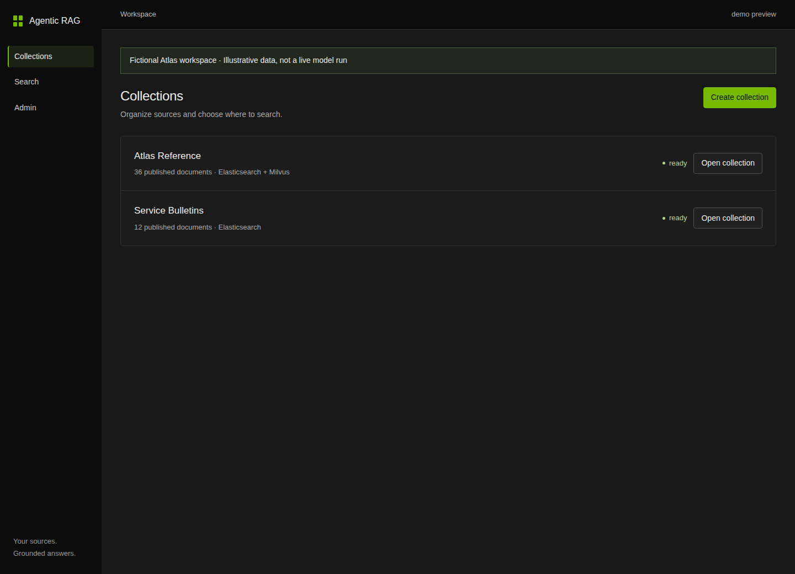](images/01-collections.png)

Give the collection a recognizable name. Elasticsearch always receives its content; selecting **Also write to Milvus** adds the GPU-search projection. You can add Milvus later instead.

[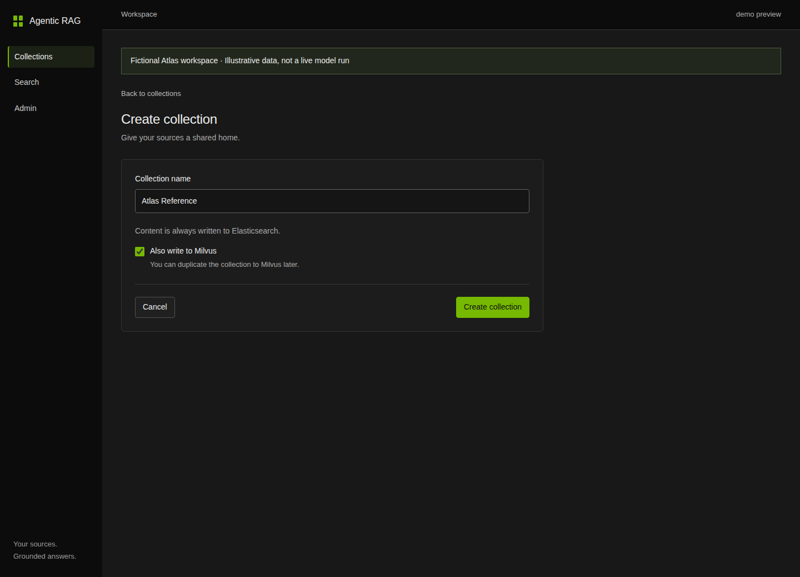](images/02-create-collection.png)

| Entry | How to use it |
|---|---|
| Collection name | A user-facing label describing what people will search, such as `Atlas Reference`. |
| Also write to Milvus | Enroll this collection in the additional Milvus projection. The search page separately chooses which index to query. |
| Create collection | Create the destination, then add files, a website or a connected location. |

## Collection overview

**Add files**, **Add website** and **Connect location** all target the open collection. **Search collection** opens search with it selected.

[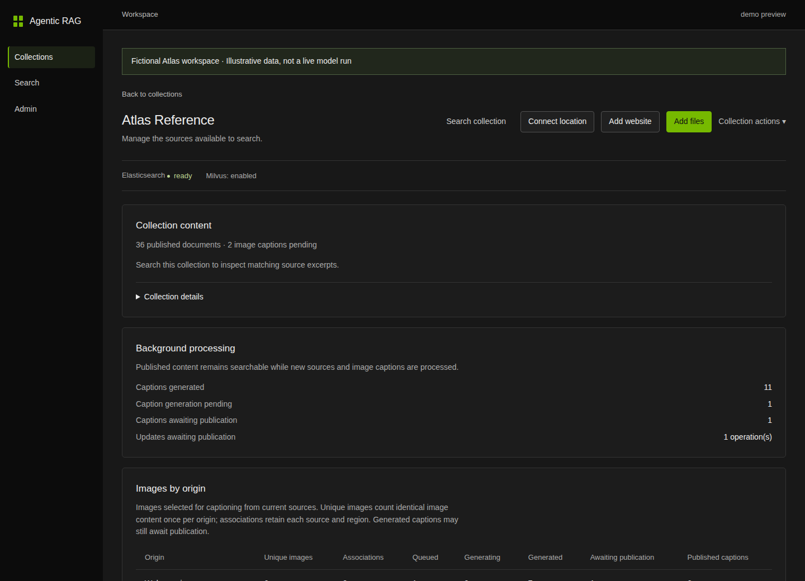](images/03-collection-overview.png)

| Area | Meaning |
|---|---|
| Elasticsearch status / Milvus enabled | The default index's status and whether the collection is enrolled in Milvus. |
| Published documents | Sources available through the published collection view. This is different from the number of extracted/indexed records. |
| Background processing | Work still running while existing content remains searchable. Queued, generating, generated and awaiting-publication counts are separate; pending updates do not make existing content unavailable. |
| Images by origin | Distinguishes webpage images, PDF regions and other document images when present. Unique images deduplicates identical content within an origin; associations counts its source/region relationships. |
| Collection details | Optional technical identifiers and generation information; normal ingestion does not require editing these. |

The example deliberately shows published documents alongside pending updates. Caption generation pending counts only queued/running inference. Captions awaiting publication counts successfully generated associations waiting for downstream admission and store receipts. Generated counts include successful inference that may still await publication; published counts represent searchable captions. Visible collection/source progress refreshes every five seconds and when the browser tab returns to the foreground.

## Upload files

Use **Add files** for a one-time upload. Choose supported local files, review their names/sizes, then select **Upload and process**.

[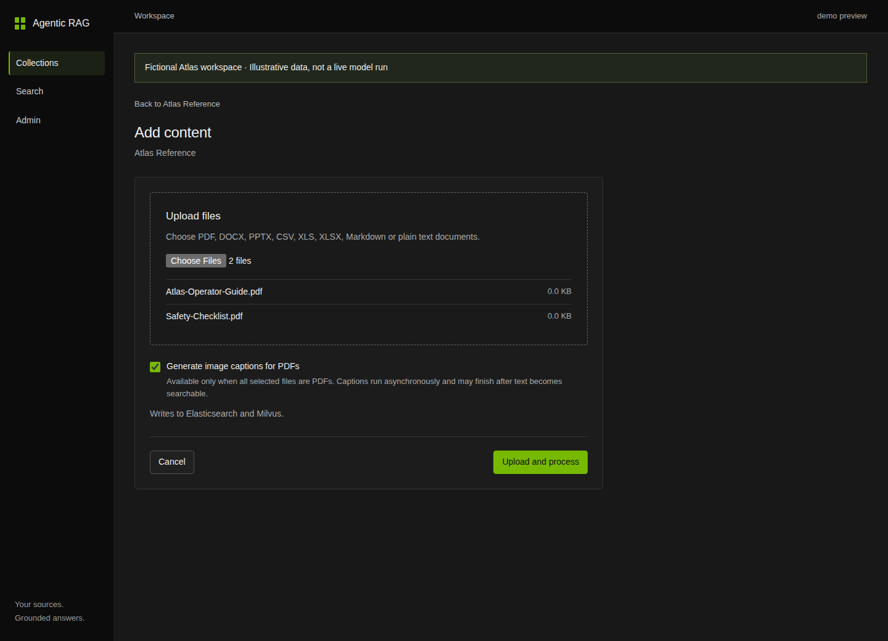](images/05-upload-files.png)

| Entry | How to use it |
|---|---|
| File picker / upload area | Select one or more PDF, DOCX, PPTX, CSV, XLS, XLSX, Markdown or plain-text files. |
| Generate image captions for PDFs | Optional. Enabled only when every selected file is a PDF; mixed formats disable it. Text can become searchable before captions finish. |
| Destination message | Confirms Elasticsearch and, when enrolled, Milvus. |
| Upload and process | Admit the upload and create an ingestion job; follow its activity on the collection page. |

Office structural/visual extraction does not depend on the PDF-only caption checkbox. Uploads have no recurring scan schedule: use **Replace file** for an on-demand replacement, or connect a directory/document URL for regular checks.

## Crawl a website

Use **Add website** to discover HTML pages through links, optionally including linked documents and images.

### Name and daily checks

[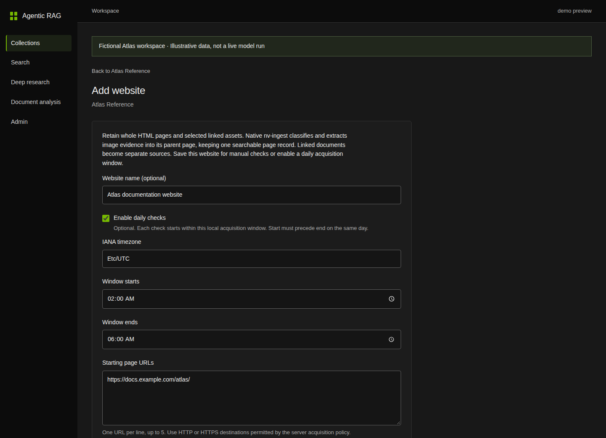](images/06-webcrawl-scope.png)

| Entry | Example and meaning |
|---|---|
| Website name | Optional readable label: `Atlas documentation website`. |
| Enable daily checks | Revisit the saved source automatically. Leave off for manual checks after the initial capture. |
| IANA timezone | `Etc/UTC` in the example; choose the timezone for the acquisition window. |
| Window starts / ends | Example `02:00`–`06:00`. Start must precede end on the same local day. This is an acquisition window, not a model-completion deadline. |
| Starting page URLs | One HTTP(S) seed URL per line, up to five. Example: `https://docs.example.com/atlas/`. |

### Scope and depth

[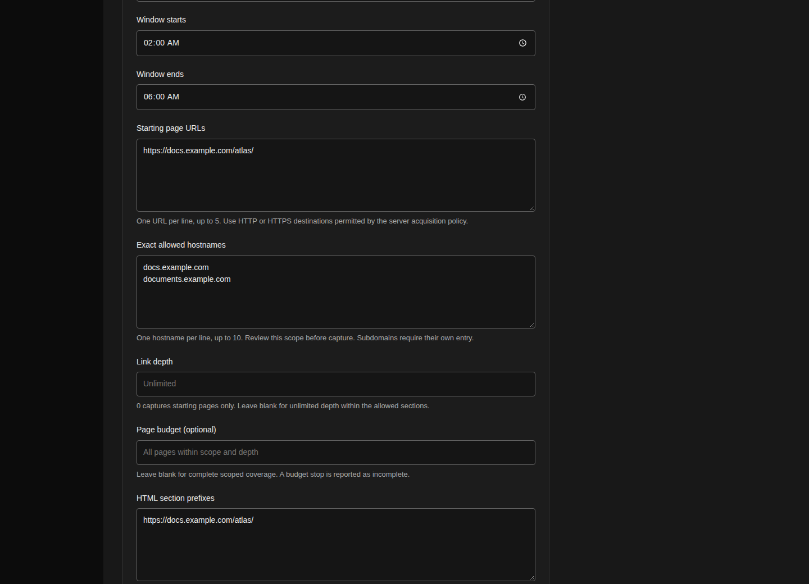](images/06b-webcrawl-boundaries.png)

| Entry | Example and meaning |
|---|---|
| Exact allowed hostnames | One hostname per line, up to ten. Here `docs.example.com` and `documents.example.com` are permitted separately. Each additional subdomain needs its own entry. |
| Link depth | `0` captures only the starting pages; positive values follow that many levels. Blank means unlimited depth within the allowed scope. |
| Page budget | Optional maximum pages. Blank requests complete scoped coverage. A budget stop is reported as incomplete, rather than silently treated as a complete crawl. |
| HTML section prefixes | Full URL prefixes such as `https://docs.example.com/atlas/` keep HTML navigation inside the relevant section. |

Hostname permission and HTML-path scope serve different purposes. Here HTML stays under `/atlas/`, while its linked documents may be elsewhere on an explicitly allowed host. Listing a parent domain does not authorize all its subdomains.

### Linked files and images

[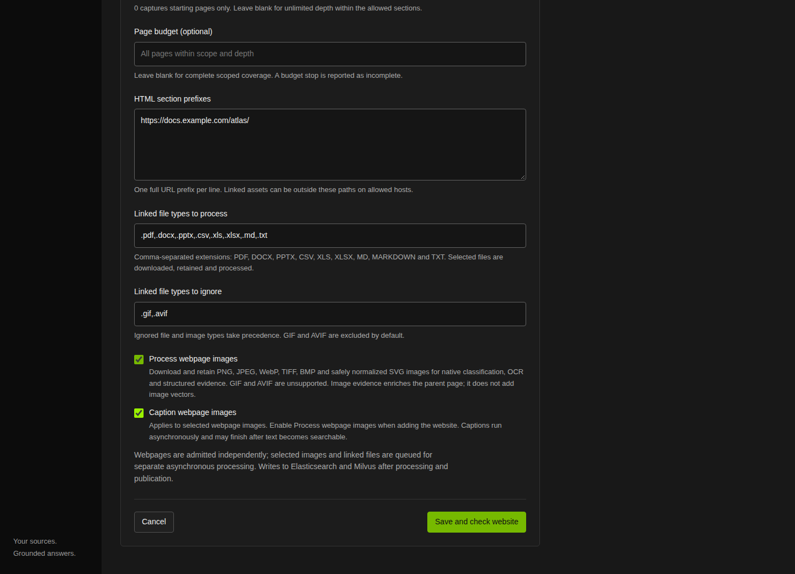](images/07-webcrawl-assets.png)

| Entry | How to use it |
|---|---|
| Linked file types to process | Comma-separated document extensions. Defaults include PDF, DOCX, PPTX, CSV, XLS, XLSX, MD and TXT; MARKDOWN is also supported. |
| Linked file types to ignore | Exclusions take precedence. GIF/AVIF are excluded by default and unsupported for this image path. |
| Process webpage images | Retain images for native classification, OCR and structured evidence. Supports PNG, JPEG, WebP, TIFF, BMP and safely normalized SVG. |
| Caption webpage images | Optional, available when image processing is selected. Eligible images enter the independent caption queue. |
| Save and check website | Save the source and queue its first check. Future checks use its saved settings. |

Webpage text is admitted independently of linked downloads, binary extraction and image/caption processing. Image evidence/captions enrich their parent page rather than adding standalone webpage-image vectors. Identical retained image bytes reuse captioning and embedding within a collection when the model and effective processing contract match. Repeated occurrences retain their parent/source links; repeated image regions in one document publish one content-derived caption record, including when replacing an equivalent older record. Distinct parent documents keep their own evidence associations. Hashes compare exact retained model-input bytes after the existing normalization; no perceptual similarity matching is introduced. Different hashes remain distinct inputs. Linked binary documents become separate sources. Legal/disclosure text can be represented separately from the main page text.

## Connect a directory or document URL

Choose **Connect location** for an approved server directory or one supported document URL. Use **Add website** for discovering HTML through links.

### Registered directory

[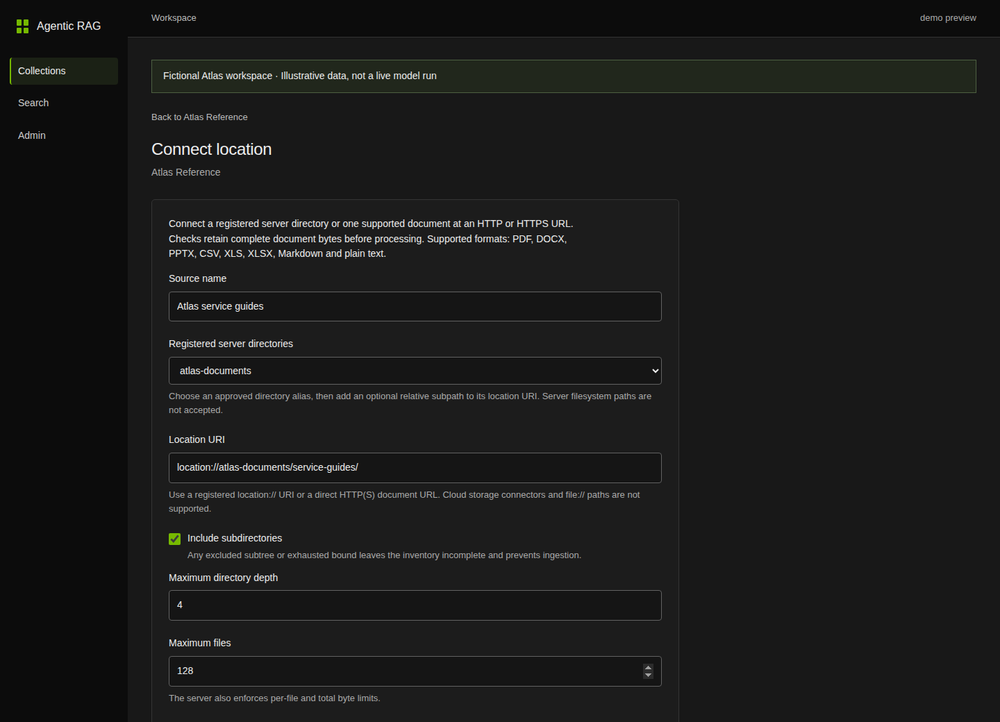](images/08-directory-source.png)

| Entry | Example and meaning |
|---|---|
| Source name | `Atlas service guides`, the label in the collection's source list. |
| Registered server directories | Select an administrator-approved alias; users do not enter host filesystem paths. |
| Location URI | `location://atlas-documents/service-guides/` selects a relative subdirectory beneath that alias. |
| Include subdirectories | Include nested directories in the inventory. |
| Maximum directory depth | Bound traversal; this example uses `4`. Excluded subtrees/exhausted bounds leave an incomplete inventory instead of silently publishing a complete one. |
| Maximum files | Bound each inventory; the example uses `128`. Server byte limits and policy also apply. |

### Captions and recurring checks

[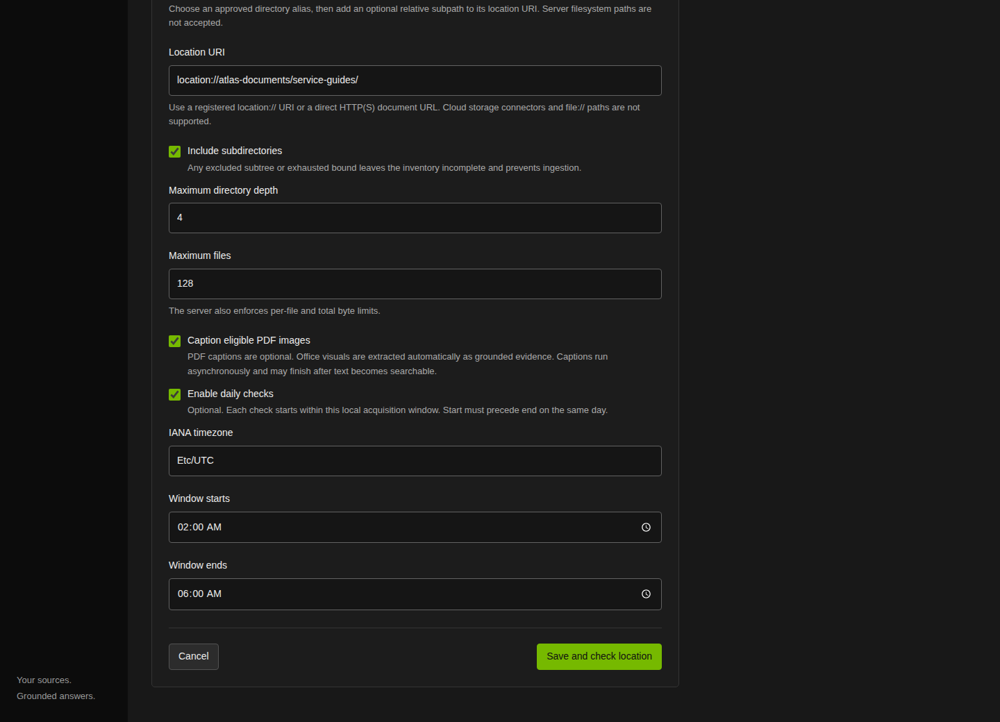](images/09-location-schedule.png)

**Caption eligible PDF images** enables optional PDF captions for this source. Office visual evidence is extracted automatically. Daily checks use the same timezone/window controls as websites. Rechecks retain source bytes and compare content/processing identities so unchanged inputs can avoid repeated model work.

Select **Save and check location** to save it and request the first check.

### Direct document URL

Entering an HTTP(S) document URL changes the form to document-download options:

[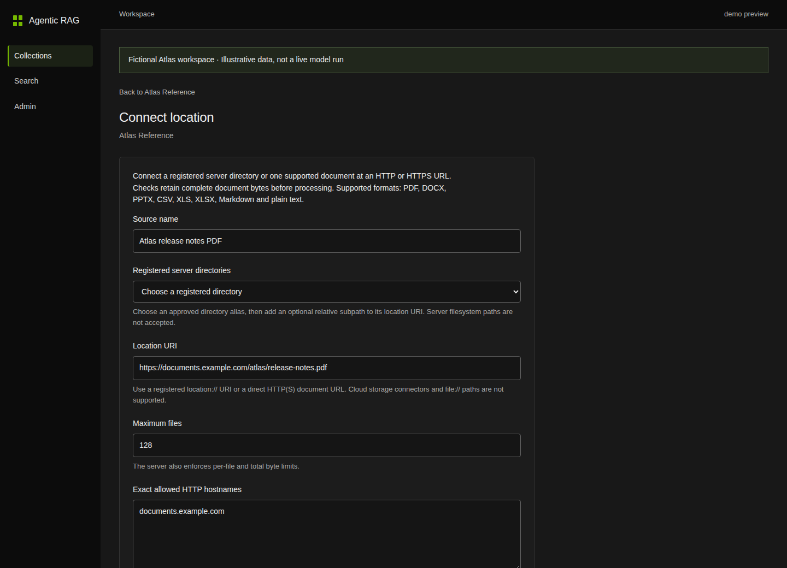](images/10-document-url.png)

Use a direct supported document URL, such as `https://documents.example.com/atlas/release-notes.pdf`. **Exact allowed HTTP hostnames** defaults to the document's host if blank; explicitly include redirect hosts when needed, subject to server policy. Arbitrary `file://` paths and cloud-storage connector schemes are not supported by this form.

## Edit sources and schedules

**Data sources** lists admitted websites, directories and document URLs, alongside uploaded files.

[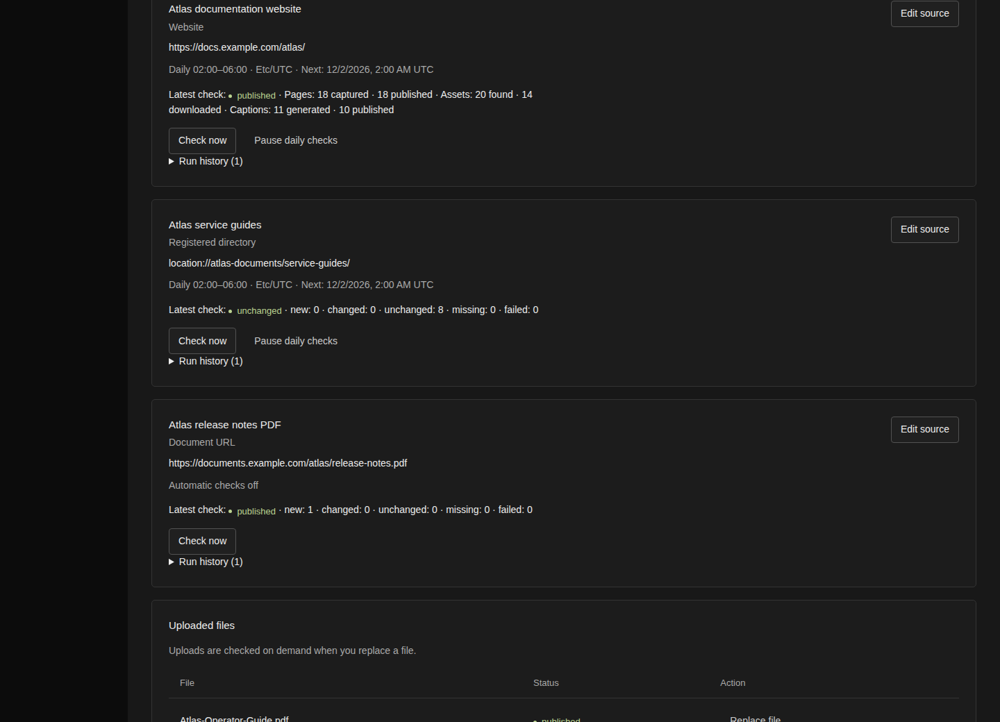](images/04-saved-sources.png)

| Control | Effect |
|---|---|
| Edit source | Change the label, acquisition scope/location, caption choice or future schedule. |
| Check now | Request a manual check using the saved settings. |
| Pause / Resume daily checks | Control future automatic checks. This does not delete published content or cancel an already running ingestion job. |
| Run history | Inspect prior checks and outcomes such as published, unchanged or failed. |
| Replace file | Submit a replacement for an uploaded source; uploads are checked on demand. |
| Set up rechecks, when shown | Turn a one-time admitted input into a source with editable future checks. |

The lower part of **Edit source** contains recurring schedule and pause controls:

[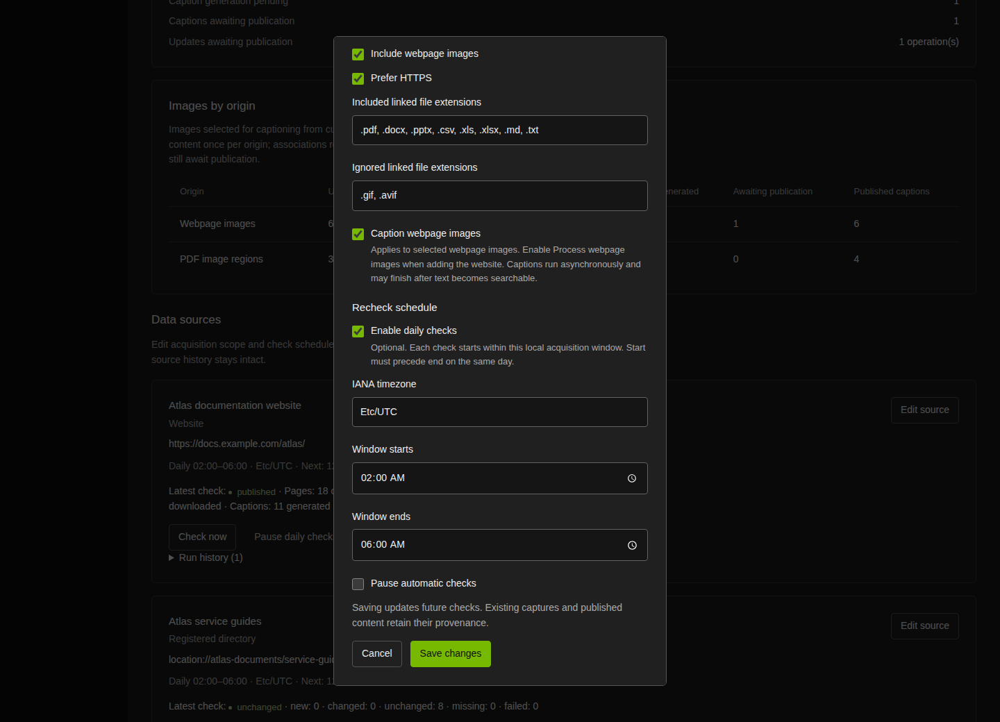](images/11-edit-source-schedule.png)

Website editors also expose URLs, hosts, prefixes, limits, extensions, image inclusion and **Prefer HTTPS**. Location editors expose the URI/URL and directory options. Saving updates future checks; prior captures and provenance remain recorded.

## Follow ingestion progress

Job views separate document processing, linked assets and optional captions:

[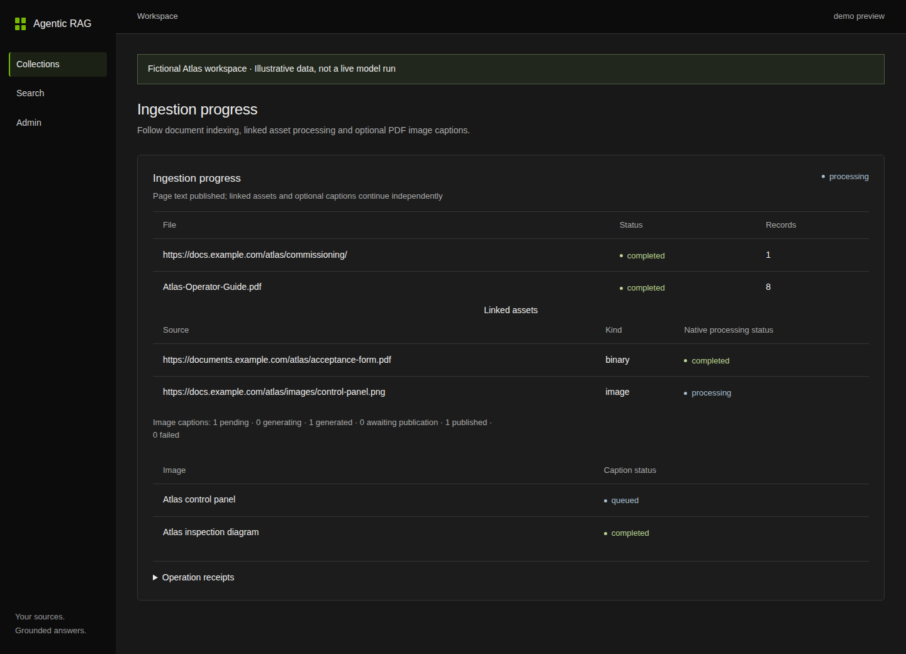](images/12-ingestion-progress.png)

| Area | Meaning |
|---|---|
| File / Status / Records | Per-document progress and derived-record count. One document may create multiple records. |
| Linked assets | Binary/image work and native processing state. |
| Image captions | Generating, generated, awaiting-publication, published and failed counts, with relevant individual-image statuses. |
| Operation receipts | Optional per-store publication details for the job. |

Text remains searchable while independent assets/captions continue. A generated caption may still await admission/publication; inference and publication are different stages. Deleted/undersized images are not actionable caption failures. Pending work alone does not imply a failed page.

## Search and research modes

Open **Search**, or **Search collection** to preselect a collection.

[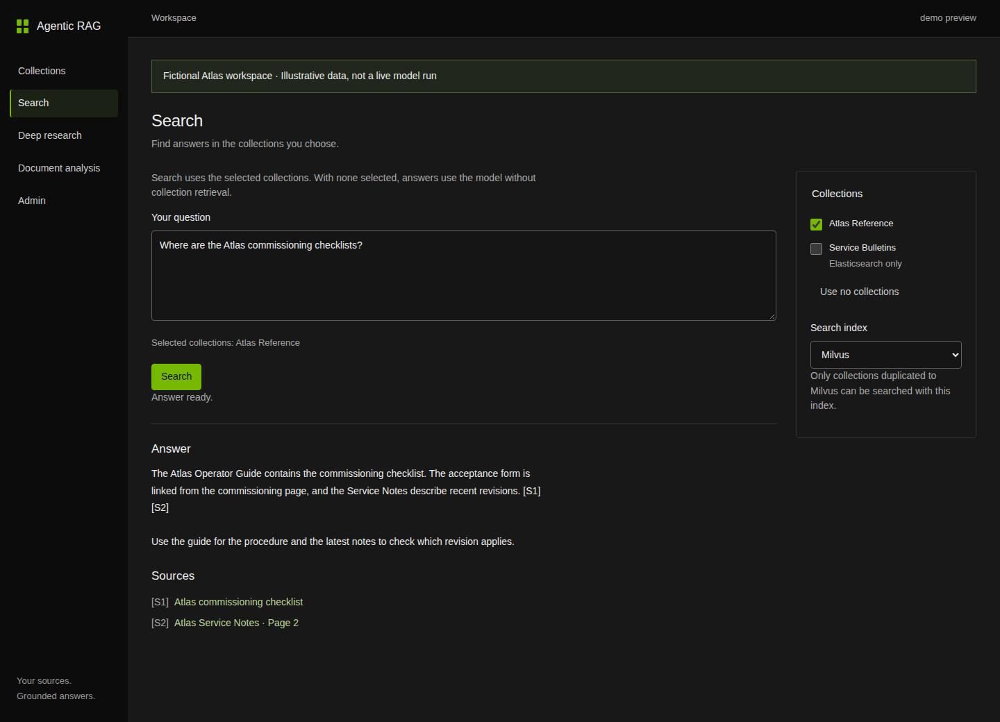](images/13-search-results.png)

| Entry | How to use it |
|---|---|
| Your question | Enter the question to answer. |
| Collections | Select one or more collections. Default retrieval is global top 10 across the chosen scope, reranked to the best 5. |
| Search index | Choose Elasticsearch or Milvus. All selected collections must be available in Milvus to use that backend. This does not change ingestion destinations. |
| Search | Run ordinary retrieval and stream the answer. |
| Sources | Follow the linked citations; PDFs may include page numbers. These are evidence links rather than pasted excerpts. |

### Deep research is a user choice

Select **Deep research**, then **Start deep research**. Changing the radio button does not run it by itself.

[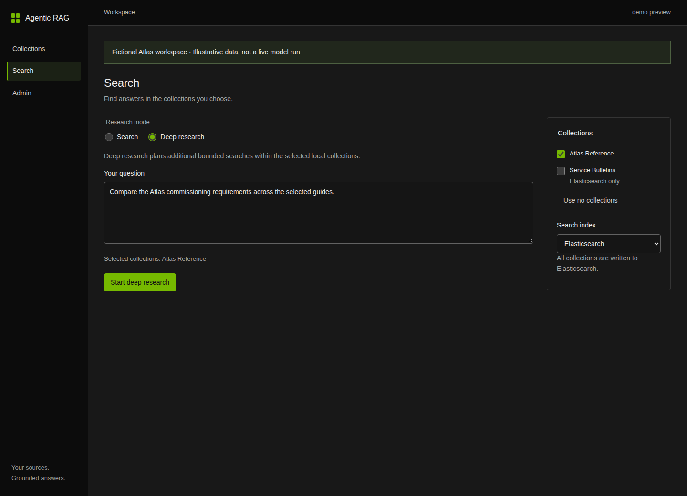](images/14-deep-research-choice.png)

The current mode plans additional bounded searches within selected local collections. It does not automatically switch a prompt to unrestricted internet research.

### No collection selected

Choose **Use no collections** for model-only answers, without local retrieval or collection citations.

[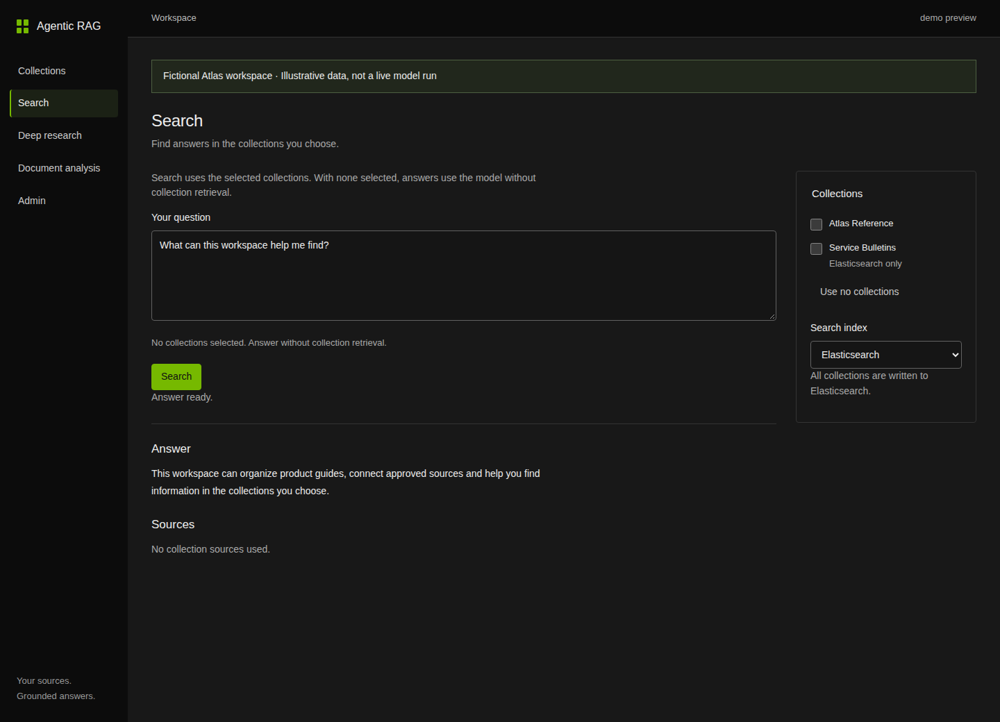](images/15-model-only-search.png)

## Duplicate or delete a collection

An Elasticsearch-only collection offers **Duplicate to Milvus**. The example uses the fictional **Service Bulletins** collection.

[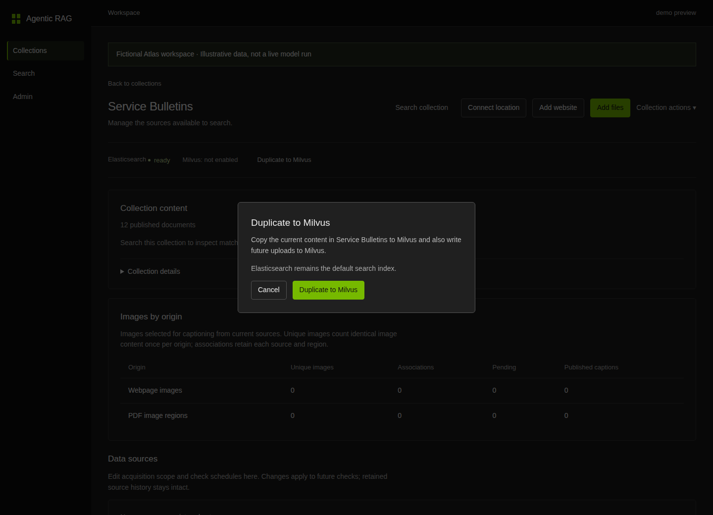](images/16-duplicate-to-milvus.png)

Confirming requests a copy of current content into Milvus and enables future writes there. Elasticsearch remains the default destination. The operation and required store receipts are tracked; choosing Milvus on the search page does not copy a collection.

**Collection actions → Delete collection** opens a separate confirmation. Type the exact collection name to remove it from search and request cleanup of its selected-store projections.

[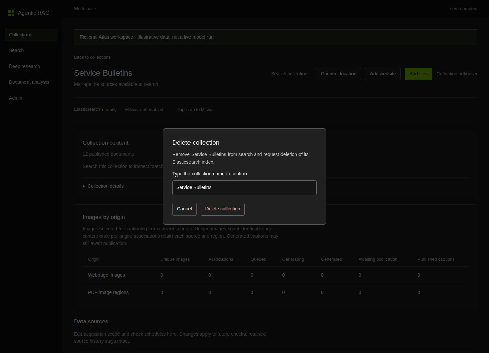](images/17-delete-confirmation.png)

This is a collection lifecycle action, not a way to delete arbitrary source directories. Physical retention/cleanup follows server durability and retention rules.

## Administer approved locations

**Admin** is separate from ordinary collection building. Sign in using the operator-configured local administrator account. `demo-admin` is an illustrative name, not a shipped account/default credential.

[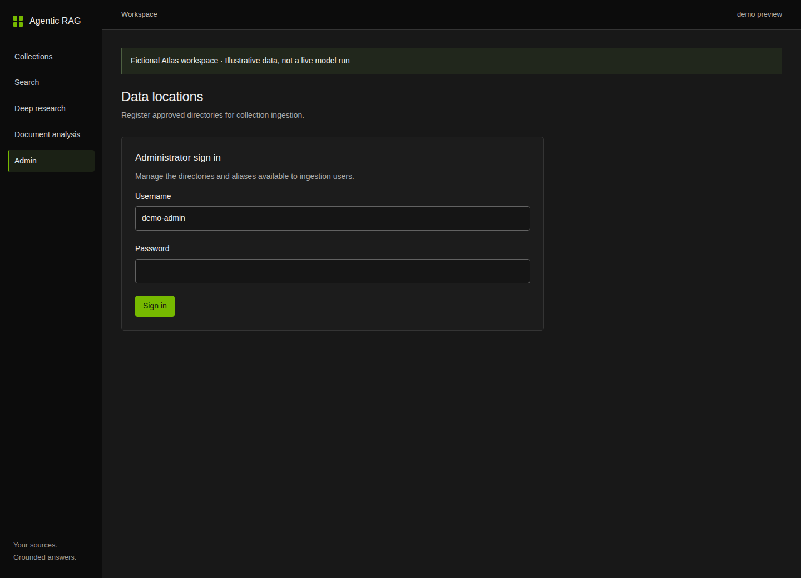](images/18-admin-login.png)

Register the aliases offered by **Connect location**:

[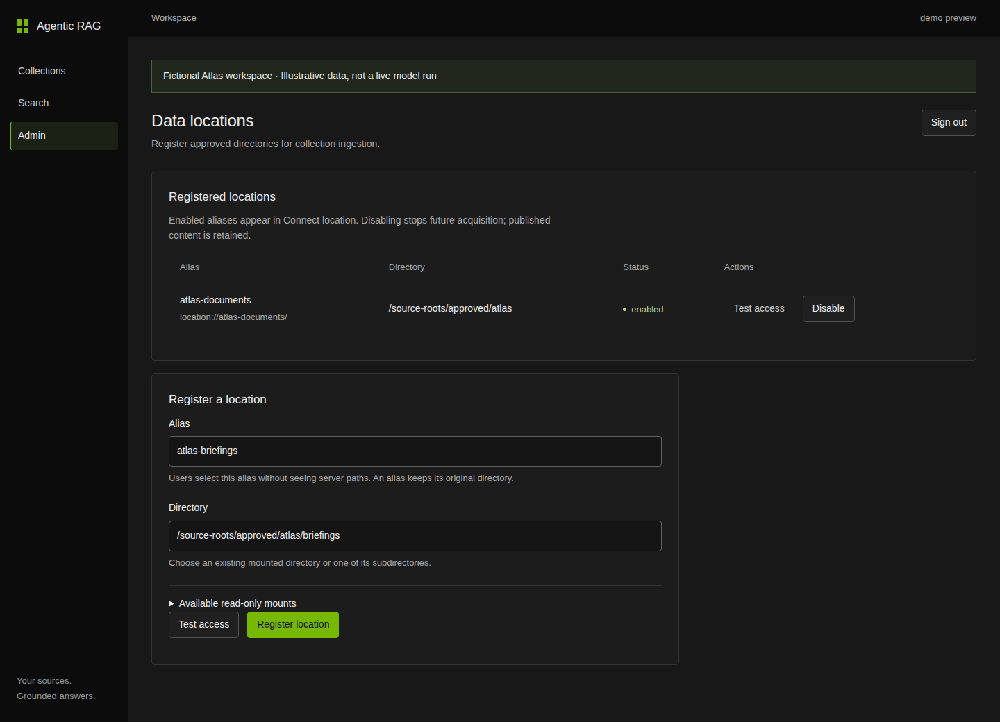](images/19-admin-locations.png)

| Entry / control | How to use it |
|---|---|
| Alias | A stable user-facing name such as `atlas-briefings`, used in a `location://` URI. |
| Directory | An existing directory inside an approved read-only mount, such as `/source-roots/approved/atlas/briefings`. These are illustrative container paths, not host paths. |
| Available read-only mounts | Inspect operator-configured boundaries. Additional mounts require deployment configuration first. |
| Test access | Check accessibility through the approved mount. |
| Register location | Save the alias/directory association. An alias keeps its original directory; use a new alias for a different one. |
| Disable / Enable | Stop or restore future acquisition through an alias. Published content is retained. |

## Explore the fictional preview

Run the same preview without models or real data:

```bash
python3 docs/gui/demo_server.py --port 8099
```

Open `http://127.0.0.1:8099`. It serves the real frontend with synthetic API responses and binds only to loopback. It does not crawl, ingest, call models or persist collection/source changes. Search and admin sign-in are simulated; production authentication is not exercised.

[`demo_server.py`](demo_server.py) defines the fixtures. [`capture.js`](capture.js) records the illustrated states with Playwright from the repository root. [`screenshots.json`](screenshots.json) records screenshot hashes. The publication audit admits only these approved fictional PNGs and continues to reject downloaded corpora and other binary files.

### Refresh screenshots

With Playwright CLI and its browser configured, start the preview above and run these commands from the repository root:

```bash
playwright-cli -s=gui-guide open http://127.0.0.1:8099
python3 - <<'PY'
from pathlib import Path
import subprocess
subprocess.run(['playwright-cli', '-s=gui-guide', 'run-code',
                Path('docs/gui/capture.js').read_text()], check=True)
PY
playwright-cli -s=gui-guide close
```

The capture script verifies the fictional preview before recording any screen. Review the images, then run `python3 docs/gui/update_manifest.py`, stage the documentation and run `python3 tools/audit_publication.py`. Other binary files and images with text metadata remain excluded.
